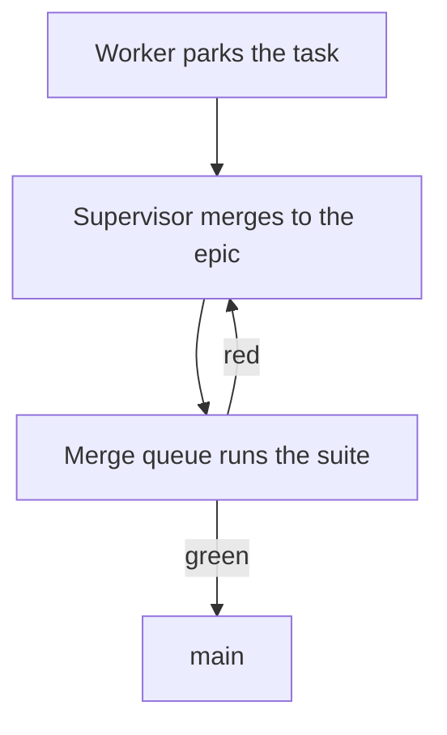

# Phone reply contract

On a Claude/Codex supervisor, answer a verified Commander question once in the final pane reply; the mirror carries it to web, phone and offline catch-up. Use [explicit operator routing](reference.md#verified-commander-messages) only for unprompted updates or confirmed disabled/unmirrored delivery.

The same Markdown reaches the terminal pane and Commander. Commander draws diagrams, colored code, tables and callouts, and the operator reads a picture faster than a paragraph, so show content visually and keep prose as the fallback:

- Answer first: the first line is the answer in one sentence.
- Then give each kind of content its form from the table below. Use bullets (at most 5, one line each) only for content no form fits.
- Bold the decision word or the thing waiting on the operator.
- Keep the prose under ~600 characters unless the operator asks for detail. A diagram, code block or table does not count against it; use at most one of each per reply, and keep a diagram to about 10 nodes so it reads on a 390 px phone.
- Do not include file paths or ticket IDs unless the operator asks for them.
- Do not narrate the process.

| Content | Form | Write | Terminal pane shows |
|---|---|---|---|
| A flow, dependency, state change or timeline | Diagram | a `mermaid` fence; `flowchart TD` stays narrow on a phone | the Mermaid source as a code block |
| Bad news, a blocker, a risk or a decision | Callout | `> [!WARNING]` for bad news or a blocker, `> [!CAUTION]` for a destructive or irreversible step, `> [!NOTE]` for a decision or context, each body line also starting with `>` | a quote block with the marker as text |
| A command, config or code | Code block | a fence with a language tag; `bash`, `ts`, `js`, `json`, `python` and `rust` are colored, `diff` opens a change view | a code block |
| A comparison of options, workers, gates or before/after | Table | a pipe table: a header row, a dash rule row, then data rows; start and end every row with a pipe | the table |

For example, asked how a merge reaches main while the queue is red:

````markdown
Merges reach main only through the merge queue, which reruns the full suite first.



```bash
# newest runs on main first
gh run list --branch "main" --limit 3
```

> [!WARNING]
> **Blocked:** the queue is red on two Commander journeys, so nothing reaches main until they pass.

| Gate | Runs | Blocks main |
|---|---|---|
| Worker check | capped check and named tests | no |
| Merge queue | full suite and journeys | yes |
````
