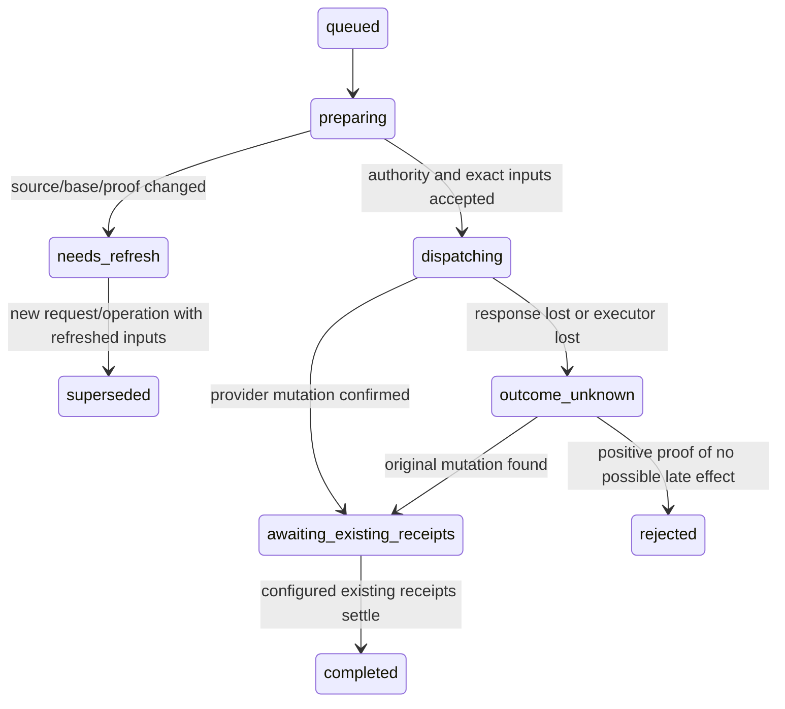

# Multi-supervisor ownership and target coordination

Task: cas-a613. Spec record: **spec-022d, under review**. Source: [GH #1215](https://github.com/Richards-LLC/cassy/issues/1215),
§3.5 and §4. Reviewed source base: `720640669` on v43.

**Proposal for operator approval; no implementation is authorized by this
document.** The supervisor approved the split, not the target design. After
operator approval, create (a) external claims and routed wakes, then (b) target
coordination and the ownership view, depending on (a). Do not create those tasks
or change repository permissions, merge policy or release flow before approval.

## 1. Outcome and scope

Two supervisors sharing a repository and Slack channel must divide the six asks
in the field report without a private messaging protocol. Both may discover an
unclaimed ask; only the successful claimant may work or reply for that thread.
Later activity reaches its owner. Handoffs have receipts. Staging writes and
promotion holds serialize through an enforced writer, and peers can see current
owners, asks, PRs, workers and pending target operations.

This delivery is a specification only. It neither implements the contracts below
nor proves the six-ask outcome. All API additions below are **proposed**. Existing
task/epic leases, peer messages, protected-main checks and release publication
remain separate contracts. V1 external work supports Slack threads only.

## 2. Existing behavior and the seams to change

| Existing source | Confirmed behavior | Design consequence |
| --- | --- | --- |
| [peer_claims.rs](../../cas-cli/src/cloud/peer_claims.rs), module contract and `PeerBudget` | Task/epic locks are account-private and advisory on outage; bounded waiting uses `spawn_blocking` | Do not reuse their local-proceed semantics for authority; timeout cannot cancel a mutation |
| [coordinator.rs](../../cas-cli/src/cloud/coordinator.rs), claim/renew/release | Existing task-lock requests lack operation idempotency and expected-generation enforcement | Add separate coordination resources; do not widen private task-lock visibility |
| [violet_activity.rs](../../cas-cli/src/ui/factory/daemon/runtime/violet_activity.rs), `poll_once` and sweep admission | Push events have claim/ack and local dedupe; watched-channel sweeps independently enqueue wakes | Both producers must enter one routing/admission contract |
| Cloud `lib/violet/activity-queue.ts`, `claimActivity`; `docs/API-REFERENCE.md` §Violet Activity Relay | Current Cloud event leases are disjoint across consumers, not a per-supervisor fanout ledger | Explicit reader deliveries are needed; do not describe existing Cloud leasing as broadcast |
| Violet `apps/violet/lib/cloud-relay.ts`, `visibleAck` | 👀 acknowledges relay acceptance/listener presence | A reaction is never work ownership or permission to reply |
| [peers_detail.rs](../../cas-cli/src/cloud/peers_detail.rs) | Existing report contains task claims, workers, epic splits and account visibility | Extend that projection rather than introduce a second board |
| [supervisor_notices.rs](../../cas-cli/src/supervisor_notices.rs) | Durable local recovery notices can reach a successor, peer or operator | Reuse notices for recovery information, never for authority transfer |
| [target_lock.rs](../../cas-cli/src/worktree/target_lock.rs), module contract | An advisory OS lock orders Cassy-mediated merges sharing one Git common directory | It does not serialize different machines or revoke a remote writer |

Cloud and Violet observations above come from primary source checkouts at
`f176bef50e41c64829eb188b0a4f1fcc9262b287` and
`07c08bf130d0fe3d6dc18af51a2341fb1a412ea4`, respectively; the cited files have no
local changes. Their named paths are implementation ownership references, not
proof of deployed behavior or APIs already provided by Cassy. Implementation
tasks must pin deployment revisions and update their API references together.

## 3. Identity, scope and ownership

| Term | Canonical identity and rule |
| --- | --- |
| Thread | Slack `workspace_id + channel_id + root_message_ts`; timestamps remain strings |
| Ask occurrence | One qualifying human message's `workspace_id + channel_id + message_ts`; a later message in the same thread is a new occurrence |
| External-work claim | One owner for the thread, covering its occurrences until completion, release or accepted handoff |
| Logical supervisor | Cloud-issued persistent supervisor slot, authenticated principal and factory identity; survives a harness restart without treating its name as authority |
| Owner registration | Current agent registration/run bound to that slot; a successor needs an explicit new grant generation |
| Target | Verified GitHub repository node ID and full target ref, not a local path or display name |
| Operation | Durable request identity, immutable inputs, stage and provider receipts for one mutation |

Permalink variants for a root or reply must resolve to the same verified root.
Resolve through the authenticated Violet installation; do not fetch arbitrary
URLs or trust a supplied `thread_ts`, workspace name or team ID. Reject ambiguous
bindings and unsupported providers. Message edits update the same occurrence;
they do not silently create another ask or reset ownership.

**V1 requires an explicitly linked team project.** Cloud derives the team and
canonical project from the authenticated membership and verified Slack binding.
Same-account supervisors work within that scope; different accounts may share
it only as current authorized team/project members. Unlinked personal projects
receive `coordination_scope_required`; matching repository text grants nothing.
Existing private task locks stay private, including in the extended peer view.

Each Slack channel binding has one authoritative team/project mapping. Unique
thread ownership is enforced within that binding, so a project alias or second
clone cannot create another owner. Each physical GitHub target similarly has
one configured writer profile and authority binding. Reject conflicting team or
project mappings rather than create independent locks for the same target.

Cloud binds requests to a registered supervisor identity belonging to the caller.
Client-provided agent names, machine names and team IDs are labels, not credentials.
Violet uses Cloud-verifiable actor delegation for managed supervisor operations;
a shared hub bearer plus an arbitrary `agent_id` is insufficient. Workers may
have linked tasks but cannot independently acquire an owner's reply authority.

## 4. Claims, handoff and reply authority

Acquisition atomically returns one `acquired` receipt or `held` with the visible
owner. A grant contains resource ID, owner slot/registration, generation, server
expiry and operation receipt. Ownership changes increment the generation;
renew/release/complete from an older generation are rejected.

Use a 300-second idle lease, renewed by bounded background work about every
100 seconds. These are protocol defaults, not new control-loop timers. Presence
loss explains staleness but cannot steal an unexpired claim. An expired idle
claim with no unresolved effects becomes claimable. A new registration, including
the same name after `/clear`, must reacquire or explicitly rebind and receive a
new generation. Hooks only journal a release/recovery intent; they never call
Cloud. If no daemon survives, idle expiry supplies recovery.

Transfer is offer/accept: the owner offers a named eligible peer, the peer accepts,
and Cloud atomically changes owner/generation. Until acceptance, the original
owner remains responsible. An expired offer or changed claim cannot be accepted.
There is no release/acquire gap and no assignment of work without acceptance.

A claim is authority to coordinate work, not a directive to answer every message.
Existing named-human handoff rules still apply. Before a managed supervisor reply,
Violet registers a reply operation under the current claim generation. A stale
or absent grant refuses the reply, including when the caller omits ownership
fields. Non-ask announcements and human Slack clients retain their existing
authorization; they are outside the managed ask-reply guarantee.

Violet is the effect gateway for managed replies. It persists the operation before
dispatch and records the Slack receipt afterward. An uncertain Slack call remains
`outcome_unknown`; do not retry a new post merely because the request timed out.
Reconcile using provider receipts and supported lookup evidence. Absence of a
message in one read is not proof that a pending send cannot finish. An unresolved
reply pins the affected thread against conflicting reply authority or handoff.
👀 remains a relay receipt and does not acquire a claim or send an answer.

## 5. One wake per occurrence and intended reader

The settled interpretation is **one logical admission per occurrence per intended
logical supervisor**. Unclaimed activity deliberately fans out once to each live,
authorized, opted-in supervisor; it is not globally one wake. Once ownership
commits, subsequent routing decisions select only its owner. This preserves the
task's explicit unclaimed fanout while eliminating duplicate claimed-thread work.

Cloud persists the occurrence, owner generation and reader routes in authoritative
order. Claim/handoff and route decisions serialize on the thread resource. Push
delivery and sweep discovery submit the same canonical occurrence identity.
Cloud then leases reader-delivery rows; local admission keys use occurrence plus
logical reader, not producer, consumer process or lease renewal time.

- Route by thread before coalescing. Do not combine different owners into the
  current channel wake. V1 admits one occurrence row per intended reader.
- Poll/ack, local sweeps, reconnects and restarts reuse the same admission identity.
  A later occurrence in that owned thread still wakes its owner.
- Persist SQLite admission and its cursor before acknowledging Cloud. `admitted`
  means durable admission, not that the model read or completed the ask.
- A stale pre-claim unclaimed wake may already be in another supervisor's context.
  It cannot be unseen and conveys no ownership. Cancel routes not yet admitted;
  include the route generation and require current authority before work/reply.
- If a claimed owner has no eligible consumer, retain its delivery pending. Do
  not borrow `supervisor_notices`' unrelated-peer fallback for owned work.
- Handoff generates a distinct ownership-change notice referencing pending work;
  it does not replay every old ask body. Previously admitted occurrences remain
  deduplicated for that reader across an owner-generation change.

An admission belongs to the logical reader, not permanently to its original
`factory_session`. On authenticated successor registration, conditionally rebind
the existing unread admission to that registration and reactivate its local queue
row in one SQLite transaction. Keep the admission ID and occurrence key; the old
session may no longer dequeue it. Cloud retains reader-delivery recovery metadata
after admission ack and records the current registration and delivery generation.
A successor on another machine recovers that same admission through an authorized
rebind receipt, fetching any needed body through Violet in bounded background work.
An ended process's admission is not evidence that its model consumed the ask.

Track queued, dispatch-uncertain and consumed receipts separately from Cloud's
admission ack. A known unread row is resumed; a consumed row is not replayed.
If a crash prevents establishing whether model delivery happened, surface one
recovery notice with the existing admission reference instead of injecting the
ask body again. This guarantees one logical admission, not exactly-once model
observation across a crash. Current claim authority still governs any action.

## 6. Timeouts, budgets and durable outcomes

Every mutation is journaled locally with a UUID `request_id` and immutable request
digest before submission. Cloud stores the same idempotency record transactionally
with the mutation. Same ID/same input returns the same operation; changed input
returns `idempotency_conflict`. Never retry an uncertain mutation with a new ID.

| Result | Caller behavior |
| --- | --- |
| `acquired` / `completed` | Use the returned grant/receipt only for its named inputs and generation |
| `held` / `rejected` | No authority; show visible owner, stable reason and remedy |
| `pending` / `outcome_unknown` | No new authority or second effect; reconcile the original operation |
| `authority_unavailable` | Fail closed for new work/replies/target mutation; retain local evidence |

Renew/release races use expected generation. A late acquisition may have committed
after local waiting ended; status lookup discovers that original grant. A late
release cannot release its replacement. One operation produces one durable
terminal result/notification, regardless of retries.

A request has one total remote-wait budget of eight seconds, with each HTTP call
bounded by the remaining budget (at most five seconds). This bounds waiting, not
the lifetime of a server effect. Reconciliation runs in bounded background jobs
with persisted retry state, bounded batches and concurrency; it is not a poll
loop inside a turn. Hooks and the factory control loop only enqueue local work
and consume snapshots/results. No synchronous Cloud discovery at SessionStart,
SessionEnd, a wake hook or a daemon tick. No optimistic local-authority fallback.

## 7. Named proposed API changes

All additions must use stable machine-readable outcomes and errors alongside
human guidance. Receipts expose operation ID, resource, visible owner, generation,
expiry, observation time and next action. Secret delegation material is excluded
from logs, prompts, artifacts and ownership projections.

### Cloud: owned authority and routing

| Proposed surface | Required contract |
| --- | --- |
| `POST /api/coordination/external-work/claim` | Canonical project/external identity plus request ID; authenticated actor; atomic election |
| `POST /api/coordination/external-work/{id}/renew`, `/release`, `/complete` | Request ID and expected generation; monotonic ownership checks |
| `POST /api/coordination/external-work/{id}/handoffs`; `POST /api/coordination/handoffs/{id}/accept` | Offer then atomic accepted transfer, bound to offer and owner generation |
| `GET /api/coordination/operations/{request_id}` | Authorized lookup of the original request, including unknown/terminal provider outcome |
| `POST /api/coordination/activity/observe` | Trusted push or sweep observations converge on the same occurrence; no arbitrary client routing |
| `POST /api/violet/activity/claim`, `/ack` v2 capability | Authenticated supervisor slot; per-reader delivery leases with occurrence ID, generation and target; durable-admission ack |
| `POST /api/coordination/activity/deliveries/{id}/rebind`, `/receipts` | Authenticated successor recovery of the same admission; conditional registration/generation checks and queued/dispatch-uncertain/consumed evidence |
| `POST /api/coordination/external-work/{id}/reply-intents` | Register one current-generation reply operation for the Violet gateway |
| `POST /api/coordination/target-operations`; `GET /api/coordination/target-operations/{id}` | Immutable merge/promotion intent, serialized target authority and operation receipts |
| `POST /api/coordination/target-operations/{id}/cancel` | Cancel only provably undispatched work; unknown dispatch stays blocked |
| `GET /api/coordination/ownership?project_id=…&cursor=…` | Authorized, paginated projection of claims, target operations and linked work |

Cloud needs authoritative resource/generation records, request/effect journals,
handoff offers and per-reader occurrence deliveries with transactional uniqueness.
Keep these separate from account-private `/api/agents/tasks/*`. The trusted relay
service remains team-bound; add narrowly scoped observe/resolve/dispatch permissions,
not general agent impersonation or membership administration.

### Violet: verified identities and one reply gateway

Extend `violet_read` with an `external_ref` resolution form and verified
`workspace_id`, `channel_id`, `root_thread_ts` identity metadata. Cloud validates
the hub's identity proof against its team installation binding. Extend the
activity envelope with workspace identity and versioned occurrence metadata;
Cloud still derives project/team eligibility.

Extend `violet_post` for managed ask replies with `coordination_operation_id`,
`expected_generation` and `request_id`, bound to authenticated actor delegation.
The hub validates/consumes the registered reply intent, persists dispatch state
and returns the operation/Slack receipt. Omitting fields is not a bypass for a
managed ask thread. Existing unrelated posting, read scopes and worker credential
denials remain intact. Push relay and sweep observations share the Cloud observe
contract; reactions and no-session notices keep their existing non-claim meaning.

### Cassy: caller operations, jobs and one projection

Propose `coordination action=claim external_ref=<permalink>`, `claim_status`,
`release_claim`, `transfer_claim` and `accept_claim`. Mutation forms carry a request
ID and, where applicable, expected generation. Cassy allocates/journals a request
ID if omitted and returns it even for a pending result. Existing task claim actions
remain unchanged. CLI equivalents use the same domain operations and receipts.

Propose `factory action=target_operation` with purpose `merge|promotion`, configured
target, immutable source PR/head and proof references; `target_status` and
`cancel_target_operation` inspect/cancel safely. Callers submit intent rather than
perform acquire/fetch/merge/push/release themselves. No caller-supplied team or
target can escape the authorized project/writer profile.

Extend `coordination action=peers detail=true` and `cas peers --detail/--json` with
the ownership projection. Add a local request journal, cached projection and
bounded authority/routing jobs; hooks read those local records only. Use real
SQLite and narrow Cloud/Violet ports. Keep grant internals, renewals, retries and
provider reconciliation private instead of publishing a generic distributed-lock
framework.

## 8. Part (b): enforced merge fencing

A Cloud lease or an epoch in a receipt cannot stop a paused supervisor's later
`git push` or `gh pr merge`. Strict mode therefore requires a **controlled target
writer**, with repository rules/credentials denying supervisor direct mutation
of configured targets. Supervisors may still push task branches and open PRs.
The narrowly scoped executor submits the repository's existing merge operation;
it does not gain a bypass to protected `main`.

The target record has a monotonic writer epoch and one active operation. Idle
reservation expiry permits a new epoch; **dispatching/unknown does not expire into
availability**. A stale generation cannot dispatch, renew, cancel or publish a
successor's operation. An executor crash triggers reconciliation, not automatic
resubmission. A single read showing no merge is insufficient proof that an old
request cannot still arrive. Unknown work may remain blocked until a provider
terminal receipt or positively proven cancellation/termination settles it.

Changed source/base/proof inputs require a **new request ID and operation**.
`needs_refresh` never mutates the original request digest: record an explicit
superseding operation and retain the old terminal receipt. Only provably
undispatched work may be superseded; dispatching/unknown work must reconcile
first. A changed promotion input also requires the corresponding new approval.

Each writer adapter must prove a provider-enforced expected-target comparison
or the existing native merge queue's serialized final-tree semantics. Source
`expectedHeadOid` alone does not establish the target base. For a ref-publishing
staging adapter, validate ancestry and use an atomic expected-old-ref update;
never an unconditional/rewriting push. For an existing native queue, retain its
required checks and record the actual queue/merge receipt. Refuse strict-mode
activation if the selected topology cannot prove these properties.

An administrator/direct-human bypass is outside the exclusivity guarantee.
Observe it as target drift, stop affected operations and reconcile; do not label
it another successful controlled merge. If the operator declines writer
restrictions, offer a separately approved **cooperative intent** mode with an
explicit weaker guarantee. Do not call that mode fencing or claim it satisfies
part (b)'s strict acceptance criteria.

## 9. How (b) fits the release flow: operator approval required

This section applies rule-176 against the whole-flow map in cas-a677, especially
its target design and duplication matrix. The existing Cassy policy is in
[CONTRIBUTING](../../cas-cli/docs/CONTRIBUTING.md#build-assembly-and-ci-policy) and
the [release rubric](../RELEASE_SLACK_RUBRIC.md#protected-main-landing-publishes-the-release).
The GH1215 downstream staging protocol is not permission to rebuild Cassy's
retired rolling sweep, epic gate or local release suite.

| Existing stage | Proposed coordination fit | Check placement |
| --- | --- | --- |
| Worker task branch and lane CI | Unchanged; attach immutable PR/head/proof references to the intent | Existing affected worker checks and lane checks only |
| Supervisor target integration | Replace peer messages/ack waits with one ordered target operation | Validate/reuse existing input-bound receipts; no new park/pre-push/merge suite |
| Staging CI/deploy, where already required | The operation remains pending for that target's configured existing completion receipts | No duplicate suite and no wait for unrelated repository CI |
| Staging-to-main promotion | A promotion takes a hold on the staging target after preceding writes settle and captures an immutable staging SHA | Existing promotion approvals/checks remain authoritative |
| Protected `main` | Submit/enable the established PR and merge-queue path | Queue remains the only integration gate; no direct main push |
| Version, archives, publish and install | Unchanged; version rides in the epic PR and queue-built archives are adopted on publication | No new tag, release PR, local publisher or post-main gate |

The **same staging authority** covers merges and promotion holds. Locking only
`main` would not freeze staging. A granted promotion hold records the staging SHA
and promotion PR/head; new staging writes wait. The default hold ends when that
exact promotion lands on protected main, not when publishing/install finishes:
those stages operate on immutable landed inputs. A failed/ejected promotion stays
visible pending repair or explicit safe abandonment. It is not silently unlocked
by a five-minute timer. A source/target change requires a new explicit decision;
never recapture a different release under the old approval.

Delete the manual announce/peer-ack/five-minute wait protocol for managed targets.
Do not add a mandatory batching delay, extra agent hop or full-suite run. Refresh
the second operation's actual base; invalidate only proof whose inputs changed,
and reuse matching existing receipts. Preserve the one-repair-cycle queue-ejection
policy and report a second ejection under the existing operator escalation rule.

Operator approval must name each target profile, executor identity/permissions,
existing completion receipts, promotion hold endpoint and bypass/recovery policy.
An activation capability test proves stale supervisor credentials cannot write
the target; this is rollout evidence, not a new check on every merge. No production
activation or repository permission change belongs in this docs-only delivery.

Measure added coordination time within the existing stage, not as another gate:
immediate dispatch when the target is free and ready, bounded request wait as in
§6, and no unconditional scheduling delay. Record queue wait, authority wait,
provider work and existing CI/deploy time separately. Rule-176's end-to-end goals
remain commit→main ≤30 minutes and main→published ≤20 minutes. Spec approval and
green unit tests are not proof of those goals; part (b) needs real target releases.

## 10. The ownership view

Extend the existing peer report with one authorized snapshot containing:

- lane/epic split and target profile;
- thread/ask references, current owner and generation, claim/effect state;
- linked task IDs, PR URLs/head SHAs and workers;
- target operation, writer epoch, queued/unknown/CI/deploy state and receipts;
- server observation time, pagination, scope visibility and explicit stale or
  unavailable sections.

Ownership comes from authority records; worker and PR activity are observations,
not ownership. Never treat inaccessible private task locks as empty work. Remote
names are not local spawn targets. Fetch projection updates in bounded jobs or an
explicit bounded read request, then serve local snapshots to the control loop.
No per-tick GitHub/Slack inventory crawl. Missing PR details stay unknown rather
than inferred from a branch name. Surface outcome/owner before diagnostics and
retain the same fields in human and JSON output; implementation (b) owns CLI
craft/contrast/accessibility review.

## 11. Deployment and compatibility

Deploy Cloud schema/contracts first, then the trusted Violet gateway/envelope,
then capable Cassy clients. Activation is explicit per project/profile after
capability and credential checks. Managed activity uses v2 reader deliveries;
legacy consumers must not lease those rows. Older channel sweep clients must be
upgraded or disabled before strict routing is enabled. Otherwise refuse activation,
rather than claim that push-only filtering solves the duplicate-wake problem.

Activation must also stop v1 event publication and leasing for each managed Slack
binding. Atomically fence that binding's legacy ingress, invalidate outstanding v1
lease tokens and migrate or retire its pending v1 rows into canonical occurrences
before enabling v2 routes. Wait for old consumers to quiesce or disable their
managed-channel intake; invalidating a token cannot retract an already fetched
body. Refuse activation if legacy intake cannot be excluded. Retained v1 rows for
that binding are archival, never claimable. Unmanaged bindings may continue v1
delivery; existing private task claims continue independently.

Snapshot/receipt fields are additive and versioned; authority mutations
fail closed on unsupported versions. Keep Slack message bodies out of coordination
records; store provider IDs, links and minimal metadata. Apply team membership
revocation to new grants, reads and dispatches; unresolved already-dispatched
effects remain auditable and blocked from conflicting re-dispatch.

## 12. Subtask plans and acceptance

Create these tasks only after recorded operator approval of spec-022d.

### (a) External-work claims and routed wakes

Owners: Cloud authority/delivery schema and routes; Violet identity/observe/reply
gateway contract; Cassy coordination actions, journals, jobs and intake. Deliver
contract fixtures first, then the real two-machine scenario. Use real SQLite,
owned-service contract tests and deterministic barriers/clocks; mock only actual
Slack/GitHub effects and inject lost/late responses.

Acceptance:

1. Different-account supervisors in one authorized team race one canonical
   thread: exactly one acquired owner; the loser sees the permitted owner receipt.
   Aliases/root/reply permalinks converge; foreign teams and ambiguous bindings
   cannot read or mutate it. Existing private task locks are not exposed.
2. Reproduce six asks with a four/two split, one managed responder per thread and
   no peer-message negotiation. Unclaimed occurrences reach both intended readers
   once; subsequent owned occurrences reach only their owner. A later ask in the
   same thread wakes again; edits/retries do not manufacture another occurrence.
3. Push plus sweep, duplicate polls and lost ack preserve one admission per reader.
   Crash before/after admission ack, including a restart with only the successor
   supervisor alive, resumes the same known-unread admission without stranding it
   on an ended session. Test same-machine adoption and cross-machine rebind;
   consumed bodies do not replay and uncertain consumption yields a recovery
   reference. A failed SQLite enqueue is not acknowledged admitted. A stale
   pre-claim wake cannot authorize a losing supervisor reply.
4. Offer/accept races with renewal/release/reply reject stale generations. Idle
   expiry recovers a dead owner; unresolved Slack dispatch prevents conflicting
   reply/handoff. A missing owner consumer leaves claimed activity pending.
5. Commit-then-timeout and delayed requests reconcile using the original request
   ID, with no new authority, duplicate reply or contradictory terminal notice.
   Authority outage and old client capability failures are explicit and closed.
6. Slow/unavailable Cloud/Violet cannot introduce network I/O or blocking waits
   into hooks/control-loop passes. Record bounded-job and local receipt evidence.
7. Strict activation fences managed bindings from v1 publication/leasing and
   settles outstanding rows/consumers. Exercise a legacy consumer, old lease ack
   and old sweep against activation: none can bypass owner routing afterward;
   inability to quiesce intake refuses activation. Unmanaged v1 bindings still work.

### (b) Target coordination and ownership view; depends on (a)

Owners: Cloud target operations and controlled executor; Cassy intent/status,
existing merge/release entry-point integration and peer projection. Operator
approval includes the §9 profile and permission choices before implementation.

Acceptance:

1. Two staging operations serialize through their configured existing receipts.
   The second observes the resulting base and reuses or refreshes only affected
   input-bound proof. Changed inputs receive a new superseding request/operation;
   replaying the old request with new inputs refuses. No new CI job, post-merge
   suite or duplicate check appears.
2. A promotion hold and staging write cannot both dispatch. The captured staging
   and promotion PR/head remain immutable until the chosen main-landing receipt
   or explicit safe abandonment; unrelated CI/deploy does not prolong the hold.
3. A paused old supervisor's direct push/merge credentials are rejected, and stale
   epoch/source/base requests cannot dispatch through the executor. Prove the
   provider's expected-target/queue behavior for the actual target topology.
4. Crash or timeout before/after provider acceptance retains one active operation.
   Unknown dispatch prevents takeover even after lease expiry. Reconciliation
   discovers the existing effect or positively proves safe cancellation before
   permitting another write. Test administrator drift separately.
5. The board truthfully combines lane split, asks, PRs, workers and target states
   across both machines, including private/inaccessible, stale and unavailable
   sections. Read-only inventory never registers remote workers locally.
6. Main protection, one merge queue, version-in-epic-PR, publication and install
   behavior remain intact. Run the downstream staging/promotion scenario and
   three consecutive real releases; report end-to-end and added coordination
   time against rule-176, with receipts, before claiming the latency objective.

Worker validation in each repository stays targeted to changed contracts and
affected journeys. The existing merge queue owns the full merged-tree suite;
this specification adds no full worker/QA run or new release-gate row.

## 13. Alternatives, decision and approval record

Three independent read-only proposals explored a three-entry-point permit module,
two explicit grant resources, and common-caller operation workflows. Recommend
**explicit external-work claims plus durable target operations**, sharing private
identity/request/receipt machinery. Callers learn identity, generation, request ID
and pending versus terminal outcome; renewals, routing races, replay and provider
reconciliation stay behind those operations.

Reject reusing advisory task locks: it inherits private-account scope and unsafe
offline fallback. Reject a public generic `lock(key, ttl)` framework: it moves
resource policy and late-effect recovery onto every caller. A bare permit-only
interface is smaller but leaves merge preparation/dispatch/reconciliation ordering
to callers; the common target-operation workflow hides those coupled steps.

Deletion test: removing these modules would duplicate ownership election,
canonicalization, route dedupe and unknown-effect recovery across MCP actions,
Violet posting, sweeps, merge callers and the peer view. The chosen seam earns its
interface. Proposed surface critique: distinctiveness4/5 (thread versus occurrence
and target operation are explicit), fit4/5 (extends existing coordination/peer
terms), hierarchy4/5 (outcome/owner/receipt precede diagnostics). Rendering and
implementation critique remain subtask work, not executed evidence here.

Operator approval must be recorded against this document's immutable commit and
spec-022d, covering the team authority model, unclaimed fanout interpretation,
managed reply gateway, strict writer topology and §9 release-flow changes. Only
then may the supervisor approve the spec and create/staff (a) and dependent (b).
If strict writer topology is declined, record the weaker cooperative target as a
new approved scope; do not silently downgrade the fencing acceptance criteria.
